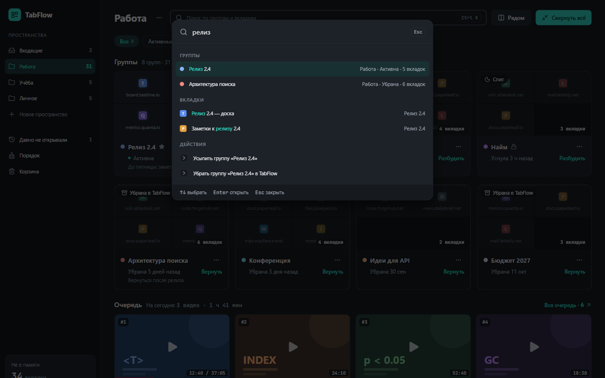
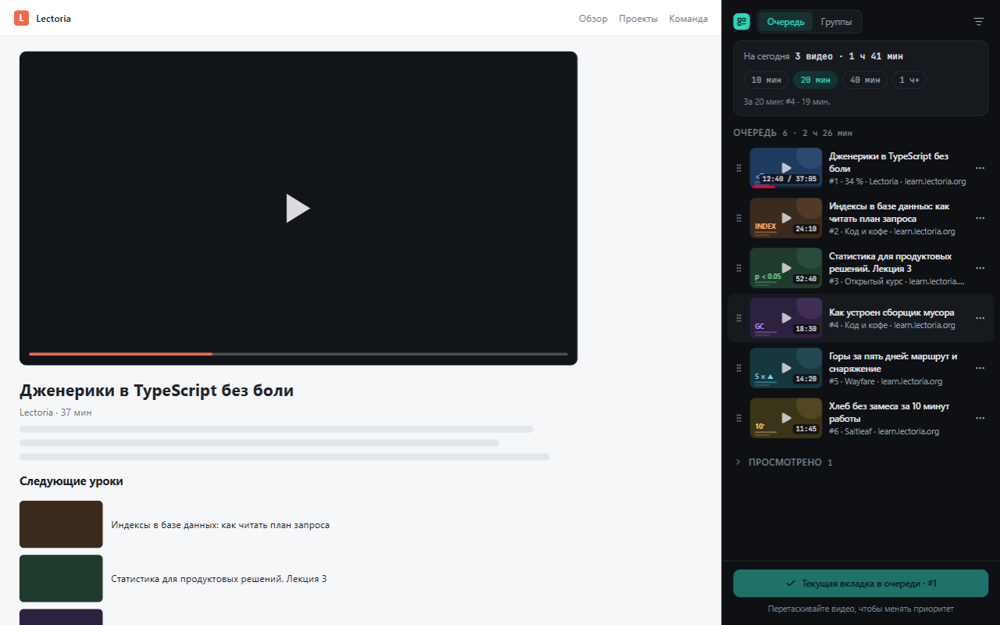
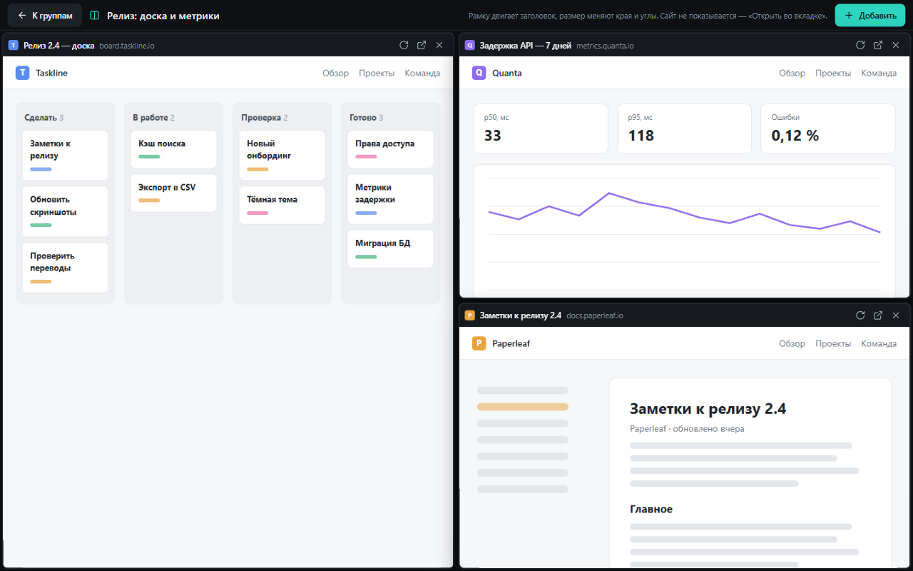
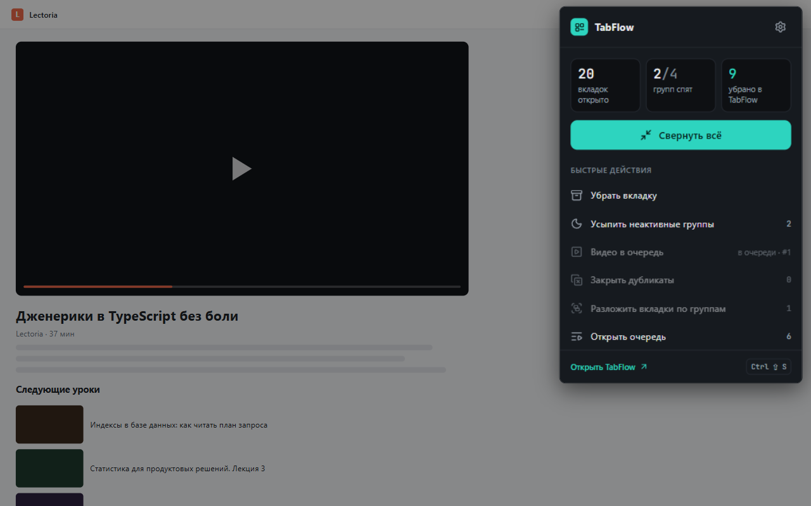
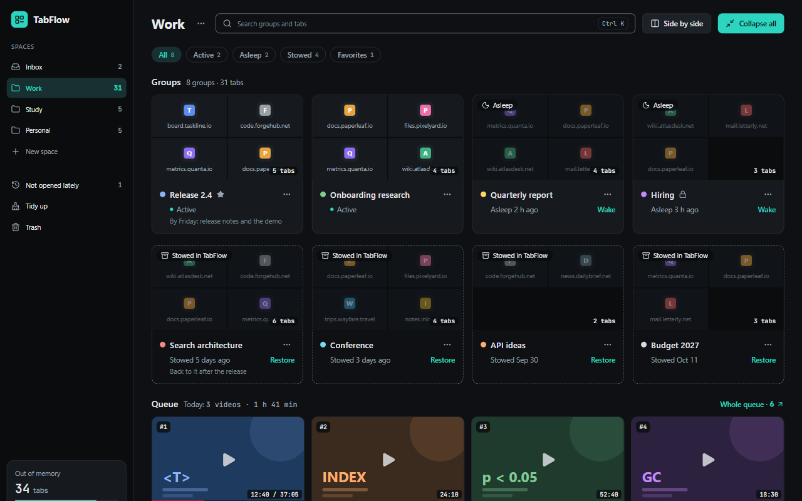

# TabFlow

**Всё на виду. Ничего в памяти.** · _Everything in sight. Nothing in memory._

Менеджер вкладок для Chrome: группы с тремя состояниями — активна, спит, убрана, — обзор плитками и очередь видео «на потом». Интерфейс на русском и английском. [English below](#english).


## Что умеет

- **Группа — три состояния.** Активна — на панели вкладок. Спит — на панели, но вкладки выгружены из памяти. Убрана — вкладки закрыты, группа хранится в TabFlow и возвращается нативной группой Chrome с тем же названием и цветом.
- **Свернуть всё** — одним кликом или `Ctrl+Shift+S`: каждая группа окна убирается отдельно, вкладки вне групп собираются в новую группу во «Входящих».
- **Плитки и пространства** — «Работа», «Учёба», «Личное»; поиск, палитра `Ctrl+K`, перетаскивание.
- **Очередь видео** в боковой панели — длительность, сколько осталось, «На сегодня» и подбор под свободное время.
- **Рядом** — 2–9 сайтов на одной странице, каждый в своей рамке.
- **Порядок** — автосон давно не открытых групп, закрытие дубликатов, раскладка вкладок по темам или сайтам.
- **Ничего не теряется** — корзина на 30 дней, «Отменить» у каждого действия, резервная копия в JSON.

| | |
|---|---|
|  |  |
|  |  |

## Установка

1. Скачать `tabflow-<версия>-chrome.zip` со страницы [Releases](../../releases) и распаковать в постоянную папку (её нельзя удалять — Chrome грузит расширение оттуда).
2. Открыть `chrome://extensions`, включить **«Режим разработчика»** (справа вверху).
3. Нажать **«Загрузить распакованное»** и выбрать распакованную папку.

Обновление — скачать новый zip, заменить файлы в той же папке и нажать «Обновить» на карточке TabFlow в `chrome://extensions`. Данные при этом сохраняются. Нужен Chrome 121 или новее (группы вкладок, боковая панель).

## Данные

- Всё хранится только в этом браузере (IndexedDB и `chrome.storage`): нет сервера, аккаунтов, рекламы и аналитики. Удаление расширения удаляет и его данные.
- TabFlow сам ходит в сеть только за обложками YouTube (`i.ytimg.com`, по id видео).
- Доступ к сайтам не выдаётся при установке: Chrome спрашивает его для каждого сайта отдельно — когда видео попадает в очередь или сайт открывается «Рядом». Убрать доступ можно в настройках TabFlow.
- Раскладка вкладок с помощью Gemini Nano (эксперимент, выключен по умолчанию) работает на устройстве: модель встроена в Chrome, вкладки никуда не отправляются.

## Сборка из исходников

Нужны Node.js и [pnpm](https://pnpm.io).

```bash
pnpm install
pnpm build
```

Готовое расширение — в `.output/chrome-mv3` (его и выбирать в «Загрузить распакованное»). Остальные команды:

| Команда | Что делает |
| --- | --- |
| `pnpm dev` | Режим разработки с перезагрузкой |
| `pnpm test` | Тесты Vitest |
| `pnpm e2e` | Сборка + e2e на Playwright (Chromium с расширением) |
| `pnpm typecheck` · `pnpm lint` | TypeScript · ESLint |
| `pnpm zip` | Zip для релиза → `.output/tabflow-<версия>-chrome.zip` |

Стек: [WXT](https://wxt.dev), React 19, TypeScript, Tailwind CSS 4, Dexie. Устройство проекта описано в [CLAUDE.md](CLAUDE.md), дизайн-система — в [design/](design/DESIGN.md).

## Лицензия

[MIT](LICENSE)

---

## English

A tab manager for Chrome: groups with three states — active, asleep, stowed — tiles at a glance and a watch-later video queue. The interface is in English and Russian (follows Chrome's language or the choice in the settings).



- **Three states of a group.** Active — on the tab strip. Asleep — on the tab strip, tabs unloaded from memory. Stowed — tabs closed, the group kept in TabFlow; it comes back as a native Chrome group with the same title and color.
- **Collapse all** in one click or `Ctrl+Shift+S`.
- **Tiles and spaces**, search, the `Ctrl+K` palette, drag and drop.
- **Video queue** in the side panel: duration, time left, "For today" and a pick for the free time you have.
- **Side by side**: 2–9 sites on one page, each in its own frame.
- **Tidy up**: autosleep, duplicate cleanup, sorting tabs into groups by topic or site.
- **Nothing is lost**: a 30-day trash, Undo for every action, JSON backup.

**Install:** download `tabflow-<version>-chrome.zip` from [Releases](../../releases) and unzip it into a folder you keep → `chrome://extensions` → turn on **Developer mode** → **Load unpacked** → pick the folder. Chrome 121 or newer.

**Data** stays in the browser: no server, accounts, ads or analytics. The only network requests TabFlow makes are YouTube thumbnails from `i.ytimg.com`. Site access is asked per site, only when a video is queued or a site is opened side by side. Sorting tabs with Gemini Nano (experimental, off by default) runs on the device.

**Build:** `pnpm install && pnpm build` → `.output/chrome-mv3`.

License: [MIT](LICENSE).
